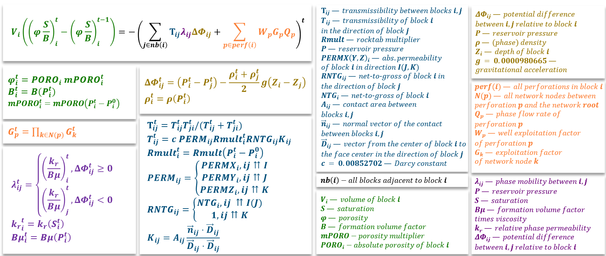

<div align="center">
  <!--  -->
  <h1>Omega Parser</h1>
  <p><strong>TNavigator simulation files parser and processor in Python.</strong></p>

  [](./CHANGELOG.md)
  [](./LICENSE)
</div>


## Description

A Python library for cleaning, parsing TNavigator input and output files with possible data extraction and data management with a comprehensive configuration support.

<br>

## Features

- 🛢️ TNavigator input `DATA` file cleaning and parsing (at least 67 keyword parsers: PVDG, WECON, DATES, GRUPTREE, VFPPROD, UDQ, WELSPECS, COMPDAT, WCONPROD, etc.)
- 📊 `RSM`, `UNSMRY` summary files and binary `RES` files parsing with time-series data extraction
- ⚡ `ContextManager` for sequential simulation `DATA` file data processing with state management 
- ⚙️ `Pipeline1` - easy way clean, parse and preprocess both input and output TNavigator data via YAML configuration file
- 🛢️ TNavigator full reservoir numerical schema implementation - ready for `numpy` and `torch` arrays
- 🔧 Comprehensive YAML configuration management
- 📝 Type hints and validation with Pydantic

> [!WARNING]
> The following features might not work correctly and needs refactoring:
> - 🎯 Event-driven scenario management with parameterized queries
> - 🖥️ Full-featured CLI with Click
> - 🧪 Complete testing suite with pytest using real reservoir data

<br>

## Installation

**Requirements**: Python 3.10.15 or higher

<details>
<summary> <em><strong> I. Install from Source </strong></em> (click to expand)  </summary>

```bash
git clone https://github.com/GitHub-User228/omega-parser.git
cd omega-parser
make install
```

</details>

<details>
<summary> <em><strong> II. Using pip (when published) </strong></em> (click to expand)  </summary>

```bash
pip install omega-parser
```

</details>

<details>
<summary> <em><strong> III. For Development </strong></em> (click to expand)  </summary>

```bash
git clone https://github.com/GitHub-User228/omega-parser.git
cd omega-parser
make install-dev
```

</details>

<br>
<br>

## Usage

### 1. `Cleaner` & `MainParser`

```python
from pathlib import Path
from omega_parser.utils.common import save_pkl
from omega_parser import MainParser, Cleaner

# Clean TNavigator simulation files
cleaner = Cleaner()
cleaner.clean(data_dir=Path("data/"), output_dir=Path("data_cleaned/"))

# Parse cleaned TNavigator simulation files
parser = MainParser(data_dir=Path("data_cleaned/"), verbose=1)
content = parser.read(rel_file_path="simulation.data")

# Access parsed keywords by section
pvdg_data = content.PROPS.get("PVDG")  # Pressure-volume-viscosity data
dates_data = content.SCHEDULE.timestamps  # Schedule dates with timestamps

# Save parsed content as pkl file
save_pkl(path=Path("output/data.pkl"), data=content)
```

<br>

### 2. `RSMParser` & `RSMParserParallel` & `RSMDataExtractor`

```python
from pathlib import Path
from omega_parser import RSMParallel, RSMDataExtractor

# Parse RSM summary files using batched multiprocessing approach
parser = RSMParserParallel(data_dir=Path("data/"), verbose=True)
df = parser.read(rel_file_path="summary.rsm", batch_size=1000)

# Extract well data from parsed RSM
extractor = RSMDataExtractor()
keywords = ['WGPT', 'WBP']
df_well = extractor.extract_well_data(data=df, keywords=keywords)

# Extract perforation data from parsed RSM
keywords = ['CGPT', 'CBP']
df_perf = extractor.extract_perforation_data(data=df, keywords=keywords)
```

<br>

### 3. `UNSMRYParser` & `UNSMRYDataExtractor`

```python
from pathlib import Path
from omega_parser import UNSMRYParser, RSMParallel
from omega_parser.data.simple import DType, DataLevel

# Parse UNSMRY summary files for `perforation` and `well` levels
keywords = {
  DataLevel.perforation: ['CGPR', 'CGPT'],
  DataLevel.well: ['WGPR', 'WGPT'],
}
parser = UNSMRYParser(data_dir=Path("data/"), verbose=1)
data = parser.read(keywords=keywords, io_mode='stream')
# or you can directly specify path to UNSMRY and SMSPEC files
# data = parser.read(
#   rel_file_path_to_smspec="file.SMSPEC",
#   rel_file_path_to_unsmry="file.UNSMRY",
#   keywords=keywords,
#   io_mode='stream',
# )

# Extract data from parsed UNSMRY for `perforation` and `well` levels
keywords = {
  DataLevel.perforation: {'CGPR': DType.float32, 'CGPT': DType.float32},
  DataLevel.well: {'WGPR': DType.float32, 'WGPT': DType.float32},
}
extractor = UNSMRYDataExtractor()
data = extractor.extract_data(data=data, keywords=keywords, verbose=1)
```

<br>

### 4. `OutsolTsMapsResParser`

```python
from pathlib import Path
from omega_parser import OutsolTsMapsResParser

# Parse OutsolTsMaps results file with blocks data
parser = OutsolTsMapsResParser(data_dir=Path("data/"), verbose=1)
data = parser.read(
    blocks=12, # OR np.ndarray of shape (n_blocks, 3) with coords OR Path to .xyz file with coords
    features=2, # or ['PRES', 'SWAT'],
    keep_features_order=True, 
    selected_features=None, # or ['PRES']
    selected_timestamps=None, # or like ['2022-10-01']
    output_format='dataframe', # or 'tensor',
    dimensions=None, # or like (10, 20, 33) when output_format = 'tensor'
)
```
<details>

<summary> <em>About <code>blocks</code>, <code>features</code>, <code>dimensions</code> arguments</em> (click to expand) </summary>
<br>

> Values for  `blocks`, `features`, `dimensions` arguments must be determined manually from what was specified in `.DATA` file for `RPTRST` and `RPTMAPS` keywords


</details>


<br>

### 5. `RunStatResParser`, `WellResParser`, `ConnResParser`, `GroupResParser`, `NetworkResParser`

Here is an example for `RunStatResParser`:

```python
from pathlib import Path
from omega_parser import RunStatResParser

parser = RunStatResParser(data_dir=Path("data/"), verbose=1)
data = parser.read(offset=10)
```


<details>

<summary> <em>About <code>offset</code> parameter</em> (click to expand) </summary>
<br>

> The same idea can be used for other parsers but with a different `offset` value. Check the type annotation for `offset` argument in each case in order to determine the possible values - they may be different depending on the number of `objects` (e.g. wells, connections, groups, ...), though the exact pattern rule can not be determined as for now.


</details>

<br>

### 6. `ContextManager`

The ContextManager provides sequential processing capabilities for TNavigator simulation data from `.DATA` file, managing state transitions through simulation timestamps.

<em>**Key features**</em>: 
- **State Management**: Tracks simulation state across timestamps with proper RESTART handling
- **Group, Well, Perforation, Meta Data Management**: Monitors group (GRUPTREE, BRANPROP graphs), well and perforation specifications, constraints, and production controls. Also supports meta level mnemonics
- **VFP Tables**: Manages vertical flow performance tables throughout simulation
- **UDQ**: Manages `UDQ`s throughout simulation
- **Data Validation**: Ensures consistency and validates data at each simulation step

<em>**Usage Example**</em>:
```python
from omega_parser import ContextManager
from omega_parser.data.simple import DatafileGroups

# Create from parsed content
cm = ContextManager.from_datafile(
    data_dir=Path("data/"), 
    rel_file_path="simulation.data"
)

### Alternative ways to create

# cm = ContextManager.from_parsed_content(
#     content=Path("output/data.pkl"), 
# )
# ```
# IMPORTANT: manager must be reinitialized and content must be read again 
# whenever you want to apply manager again
# ```
# cm = ContextManager.from_parsed_content(
#     content=content, 
# )
# ```
# Specify context if you already have initialized and saved context with cleared schedule data
# ```
# cm = ContextManager.from_parsed_content(
#     content=content, 
#     context=Path("output/context.pkl"), 
# )

# Initialize schedule data
cm.init_schedule_data()

# Access current state
print(f"Current timestamp: {cm.context.schedule.timestamp}")
print(f"Grid specs data: {cm.context.forecast.grid_specs}")
print(f"Well data: {cm.context.schedule.well_data}")
print(f"Perforation data: {cm.context.schedule.perforation_data}")
print(f"UDQ data: {cm.context.schedule.udq_data}")
print(f"PVT data: {cm.context.forecast.pvt_gas_data}")
print(f"SWFN data: {cm.context.forecast.saturation_water_function}")
print(f"SGFN data: {cm.context.forecast.saturation_gas_function}")
print(f"VFP data: {cm.context.schedule.vfp_data}")

# Perform a single step
cm.step()

# Perform multiple steps at once
cm.multistep(end_timestamp='2024-01-01')

# Or perform steps up until the very end
cm.multistep()

# Accumulate specific data for all timestamps
# This requires the context to be initialized again
cm = ContextManager.from_datafile(
    data_dir=Path("data/"), 
    rel_file_path="simulation.data"
)
data = cm.accumulate()

# Access accumulated data
print(f"Meta data: {data[DatafileGroups.meta]}")
print(f"Well data: {data[DatafileGroups.well]}")
print(f"Perforation data: {data[DatafileGroups.perforation]}")
print(f"Group data (GRUPTREE graph): {data[DatafileGroups.group_gruptree]}")
print(f"Group data (BRANPROP graph): {data[DatafileGroups.group_branprop]}")
print(f"VFP data: {data[DatafileGroups.vfp]}")
print(f"UDQ data: {data[DatafileGroups.udq]}")
```

<br>

### 7. Pipelines 

The Pipelines system helps to parse and process TNavigator files in an easy way with a single config file.

In order to use a pipeline, execute the following command in console:

```bash
# Runs a pipeline named `pipeline1` using `config.yaml` configuration file
python3 -m omega_parser.pipelines.run -p pipeline1 -cf config.yaml
```

#### I. Pipeline 1

Pipeline1 is designed to parse raw `.DATA` and `UNSMRY` files for either one scenario or more if they are based on the same history model. Additionally, supports `Dataset` creation from parsed data (`Dataset` itself is described later)

For each scenario the following files must exist:  
- `.DATA` files and all included files
- `result.UNSMRY` and `result.SMSPEC` files

<details>

<summary> <em><strong> Configuration File Example </strong></em> (click to expand) </summary>

```yaml
default:
  base_dir: /home/username/project1/data # where the processed is saved
  scenarios: # ids of scenarios
    - v1
    - v2
    - v3
  start_timestamp: 2024-01-01 # timestamp before which all processed data is omitted

# Defines all data processing component in the right order
components:

  # Cleans .DATA files and all included files keeping the relative tree order
  DatafileCleaningComponent: 
    save_dir: 'cleaned' # subdirectory relative to base_dir where that processed data is saved
    skip: False # whether to skip this component
    verbose: 0 # verbosity level
    data_dir: /home/username/project1/tnav_model_data # directory with .DATA file and all included files

  # Parses cleaned .DATA and included files, creating a separate .parquet 
  # or .pkl file for each data level (e.g. well, perforation)
  DatafileParsingComponent:
    save_dir: 'parsed'
    skip: False
    verbose: 1
    # Adjust the float precision - float32 or float64
    float_precision: float64
    # Truncate the naming mnemonics (like well_id, group_id)
    name_max_length: 8
    # path to a .DATA file for a history scenario relative to `DatafileCleaningComponent.data_dir`
    history_rel_dir: scenarios/history.DATA
    # path to a .DATA file for each scenario relative to `DatafileCleaningComponent.data_dir`
    scenarios_rel_dir:  
      v1: scenarios/v1_scen.DATA
      v2: scenarios/v2_scen.DATA
      v3: scenarios/v3_scen.DATA
    # what mnemonics to parse for each data level (id columns are excluded 
    # here since they are parsed by default)
    mnemonics: 
      meta:
        - COMPOFF
      well:
        - well_parent
        - well_I
        - well_J
        - VFP_id
        - WSTAT
        - WMCTL
        - WEFAC
        - WDFAC
        - exists
        - n_opened
      perforation:
        - CDFAC
        - COMPLUMP
        - WPIMULT
        - CTFAC
        - CDIAM
        - CEKH
        - CSKIN
        - CEFR
        - CSTAT
        - exists
      group_gruptree:
        - GEFF
      group_branprop:
        - PRES
        - node_fitting_flag
        - alq_flag
        - node_fitting_group_id
        - group_id_for_source_or_sink_node
        - network_type
        - VFP_id
        - ALQ
      udq: [] # keep this way in order to get UDQ data
      vfp: [] # keep this way in order to get VFP data

  # Parses UNSMRY and SMSPEC results files, creating a separate .parquet 
  # or .pkl file for each data level (e.g. well, perforation)
  ResultsParsingComponent:
    save_dir: 'parsed'
    skip: False
    # .UNSMRY file parsing mode
    io_mode: stream
    # Adjust the final float precision - float32 or float64 (WARNING: the real data have float32)
    float_precision: float32
    # Whether to delete autogenerated smpspec.csv on completion
    delete_parsed_smspec: True
    # Whether to process each block feature separately 
    # (works when block data is parsed in a separate group - like in this example)
    separate_block_features: False
    # Whether to raise an error if some keywords do not exist in the parsed UNSMRY data
    error_if_keyword_not_exist: False
    # Whether to create empty column for a mnemonic if it does not exist
    create_empty_column_if_not_exists: True
    # Value to use for empty columns
    empty_value: 0
    # Path of a txt file with blocks coordinates. Used whenever a block level data is parsed
    blocks_coordinates_file_path: /home/username/project1/tnav_model_data/blocks.txt
    # path to a directory with results files
    data_dir: /home/username/project1/tnav_model_data/scenarios/RESULTS 
    # path to a directory with results files for history relative to `data_dir`
    history_rel_dir: hist
    # path to a directory with results files for each scenario relative to `data_dir`
    scenarios_rel_dir:  
      v1: v1_scen
      v2: v2_scen
      v3: v3_scen
    # what mnemonics (with dtypes) to parse for each data level 
    # (id columns are excluded here since they are parsed by default)
    mnemonics: 
      perforation:
        CBP: float32
        CGPR: float32
        CGPT: float32
        CWPR: float32
        CWPT: float32
      well:
        WEFF: float32
      group:
        GEFF: float32    
      block:
        BSWAT: float32  
    # what data levels to parse at the same time
    mnemonics_groups: 
      - [perforation, well, group]
      - [block]

  # Preprocesses data from DatafileParsingComponent and ResultsParsingComponent
  PreprocessingComponent:
    save_dir: 'preprocessed'
    skip: False
    # Define different processing pipelines
    pipelines:
      # Example pipeline
      block_pipeline:
        skip: False
        processors:
          - method: _read_data_source
            kwargs:
              table_name: block
              alias: block
              origin: RESULTS
              mnemonics: [BSWAT]
          - method: _add_timestamps
            kwargs:
              table_name: block
              id_cols: 
              timestamps_to_keep:
                start: 2022-10-01
                end: 2035-01-01
                freq: MS
          - method: _linear_interp
            kwargs:
              x: 
              table_name: block
              features: [BSWAT]
              grouping_cols: 
          - method: _apply_time_filtering
            kwargs:
              table_name: block
          - method: _save_table
            kwargs:
              table_name: block

  # Creates Dataset(s) from parsed and preprocessed data earlier
  DatasetCreatingComponent:
    save_dir: 'datasets'
    skip: False
    # Whether to create a separate Dataset per scenario
    separate: True
    # Dataset data schema (check Dataset section later for more info)
    data_schema: ...
    # What files to use when creating a Dataset (check Dataset section later for more info)
    path_config: ...

```
</details>

<br>

#### II. Dataset from Pipeline1

Use `Dataset` from `omega_parser.data.dataset` in order to read and transform data processed via `Pipeline1` into a vectorized `numpy` format - this way the data can be processed much faster with an additional support for fast `merge` operations without `groupby`. 

You will need two YAML configuration files.

<details>

<summary> <em><strong> Data Schema Config </strong></em> (click to expand) </summary> 
<br>

This config defined data schema for `block`, `perforation`, `well`, `group` and `edge` data groups. You can specify only some of the data groups if needed.


```yaml
float_precision: float64
meta:
  extra_metadata_features: []
  features: [COMPOFF]
block: 
  extra_metadata_features: [SWATINIT, SWL, SWU] # These features are derived from ContextContextNew.pkl
  features: [BSWAT] 
perforation:
  extra_metadata_features: [I, J, K, well_id]
  features: [CBP, BSWAT, CGPR]
well:
  extra_metadata_features: [well_parent]
  features: [WEFF, well_id]
group_gruptree: 
  extra_metadata_features: []
  features: [GEFF]
group_branprop: 
  extra_metadata_features: []
  features: [VFP_id, ALQ]
```

</details>
<br>
<details>

<summary> <em><strong> Data Path Config </strong></em> (click to expand) </summary>
<br>

This config file defines directories from which to read the data. The configuration is based on how the `Pipeline1` saves the data. You can specify only some of the data groups if needed.

```yaml
data_dir: /artifacts/data
sources_path_config:
  meta:
    origin: PREPROCESSED
    filename: meta.parquet
  group_gruptree:
    origin: PREPROCESSED
    filename: group_gruptree.parquet
  group_branprop: 
    origin: PREPROCESSED
    filename: group_branprop.parquet
  well:
    origin: PREPROCESSED
    filename: well.parquet
  perforation: 
    origin: PREPROCESSED
    filename: perforation.parquet
  block: 
    origin: PREPROCESSED
    filename: block.pkl
  vfp: 
    origin: DATA
    filename: vfp.pkl
  udq: 
    origin: DATA
    filename: udq.pkl
```

</details>
<br>

Follow the code below in order to initialize the `Dataset`:

```python
from pathlib import Path

from omega_parser.data.dataset import Dataset

dataset = Dataset.from_parsed_data(
  schema_path=Path('path/to/first/yaml/file'),
  path_config_path=Path('path/to/seconds/yaml/file'),
)
dataset.add_scenario('v1')
dataset.add_scenario('v2')
dataset.add_scenarios(['v3', 'v4'])
```

Additionally, `Dataset` has `persistent_data` which is derived from `ContextContentNew.pkl` stored in `data_dir`

<br>

### 8. TNavigator Full Reservoir Numerical Schema

Use the implementation of a full reservoir numerical schema in `reservoir/equation.py`.

The schema is fully described below. The equation below works for each block `i` and timestamp `t`:



<br>

### 9. Query Processing and Event Management

>[!WARNING]
> The related code might not work correctly and needs refactoring

The Query Processing system enables event-driven scenario management for TNavigator simulations, allowing you to modify simulation behavior through parameterized events defined in Excel queries.

<em>**Key Features**</em>

- **Event Templates**: Define reusable simulation events with TNavigator keyword data
- **Parameter Validation**: Type-safe parameter handling with constraints and validation
- **Excel Integration**: Query-based scenario definition through Excel spreadsheets  
- **Date Validation**: Event scheduling with date range constraints
- **Context Integration**: Seamless integration with baseline simulation contexts

<em>**Usage Example**</em>

```python
from pathlib import Path
from omega_parser.query import QueryProcessor

# Initialize query processor with event schemas
processor = QueryProcessor(paths=[
    Path("schemas/field1_events.yaml"),
    Path("schemas/field2_events.yaml")
])

# Process scenario from Excel file
scenario_context = processor.get_scenario_data(
    context=baseline_context,  # ParsedContent from main parser
    field_alias="FIELD_A", 
    path=Path("scenarios/scenario_1.xlsx")
)

# Or process DataFrame directly  
query_data = processor.process_df(
    field_alias="FIELD_A",
    query=query_df  # DataFrame with event specifications
)

# Integrate with baseline context
updated_context = processor.add_data_to_baseline_context(
    context=baseline_context,
    query_data=query_data
)
```

<em>**Event Schema Configuration**</em>

Events are defined in YAML schema files with the specific structure:

```yaml
# field_events.yaml
field_alias: "FIELD_A"
events:
  well_constraint_change:
    name: "Well Constraint Modification"
    description: "Modify well production constraints"
    file: "well_constraint_template.data"  # TNavigator template file
    ffill: true  # Forward-fill through simulation
    date_min: "2020-01-01"
    date_max: "2025-12-31"
    parameters:
      oil_rate_max:
        keyword: "WCONPROD"
        param_name: "oil_rate_max"
        param_type: "float"
        param_min: 0.0
        param_max: 10000.0
      well_cond:
        keyword: "WCONPROD"
        param_name: "well_cond"
        param_type: "str"
        param_values: ["OPEN", "SHUT", "STOP"]
```


<em>**Excel Query Format**</em>

Scenario queries are defined in Excel files with the following columns:

| Column | Description | Type | Required |
|--------|-------------|------|----------|
| `event_id` | Event identifier from schema | str | Yes |
| `param_name` | Parameter to modify | str | Optional |
| `param_value` | Parameter value | any | Optional |
| `event_date` | Event execution date | str/datetime | Yes |
| `is_enabled` | Enable/disable event | bool | Yes |

Example Excel content:
```
event_id                | param_name     | param_value | event_date | is_enabled
well_constraint_change  | oil_rate_max   | 5000.0      | 2023-06-01 | TRUE
well_constraint_change  | well_cond      | SHUT        | 2023-12-01 | TRUE
```

<em>**Event Template Files**</em>

Event templates are standard TNavigator input files that serve as templates for event data:

```TNavigator
-- well_constraint_template.data
WCONPROD
  'WELL_01' 'OPEN' 'ORAT' 2.0 4* /
/
```

Parameters like `oil_rate_max` get substituted with values from the query.

<em>**Validation and Error Handling**</em>

The system provides comprehensive validation:

- **Type Checking**: Parameter values validated against defined types
- **Range Validation**: Numeric parameters checked against min/max constraints  
- **Value Sets**: String parameters validated against allowed value lists
- **Date Constraints**: Events validated against date range limits
- **Template Consistency**: Parameter names verified in template files

<br>
<br>

## Internal Configuration

The library uses YAML configuration files for parser setup:

```yaml
# config/config.yaml
MainParserConfig:
  end_keyword: END
  extensions:
    - ".vfp"
    - ".VFP"
    - ".inc"
    - ".INC"
    - ".grdecl"
    - ".GRDECL"
    - ".map"
    - ".MAP"
    - ".data"
    - ".DATA"
  parsers:
    - UDQParser
    - PVDGParser
    - WECONParser
    - WEFACParser
    - VFPPRODParser
    - INCLUDEParser
    - GRUPTREEParser
    - DATESParser
    - TSTEPParser
    - RESTARTParser
    - WELSPECSParser
    - BRANPROPParser
    - COMPDATParser
    - WPIMULTParser
    - WDFACParser
    - WCONPRODParser
    - COMPLUMPParser
    - WVFPDPParser

RSMParserConfig:
  extensions:
    - '.rsm'
    - '.RSM'
  end_of_file_offset: 1


RSMParserParallelConfig:
  extensions:
    - '.rsm'
    - '.RSM'

UNSMRYParserConfig:
  extensions:
    - '.smspec'
    - '.unsmry'
    
# Res file parsers configurations
OutsolTsMapsResParserConfig:
  resfile_name: outsol_ts_maps
RunStatResParserConfig:
  resfile_name: run_stat
WellResParserConfig:
  resfile_name: well
ConnResParserConfig:
  resfile_name: conn
GroupResParserConfig:
  resfile_name: group
NetworkResParserConfig:
  resfile_name: network

# Keyword configurations
PVDGParserConfig:
  keyword: PVDG
WECONParserConfig:  
  keyword: WECON
```

<br>
<br>


## Development

### 1. Setup Development Environment

```bash
# Install development dependencies
make install-dev

# Or manually
pip install -e ".[dev,docs]"
pre-commit install
```

### 2. Code Quality

```bash
# Run all checks
make check-all

# Individual commands
make test          # Run tests (WARNING - needs a review)
make test-cov      # Run tests with coverage (WARNING - needs a review)
make lint          # Run linting
make format        # Format code
make type-check    # Run type checking
```

### 3. Testing (WARNING - needs a review)

>[!WARNING]
> The related commands might not work correctly, do not cover all the possibilities of the library - a comprehensive refactoring is required

```bash
# Run all tests
pytest

# Run with coverage
pytest --cov=omega_parser --cov-report=html

# Run specific test markers
pytest -m "not slow"           # Skip slow tests
pytest -m integration          # Run only integration tests

# Test MainParser with dummy simulation data
pytest tests/test_main_parser.py -v

# Test RSM parser with sample data
pytest tests/test_rsm_parser.py -v
```

### 4. Building and Publishing

```bash
# Build package
make build

# Upload to PyPI (requires authentication)
make upload
```

<br>
<br>

## Project Structure

```
omega-parser/
├── src/omega_parser/             # Main package
│   ├── __init__.py               # Package initialization
│   ├── cli.py                    # CLI implementation
│   ├── errors.py                 # Custom exceptions
│   ├── logger.py                 # Logging utilities
│   ├── parsers/                  # Parser modules
│   │   ├── __init__.py
│   │   ├── base.py               # Base parser classes
│   │   ├── main_parser.py        # TNavigator .DATA file parser
│   │   ├── settings.py           # Configuration management
│   │   ├── keyword_parsers/      # TNavigator keyword parsers (>67 parsers)
│   │   │   ├── __init__.py
│   │   │   ├── pvdg.py           # PVDG data parser
│   │   │   ├── wecon.py          # Well constraints parser
│   │   │   ├── dates.py          # Schedule dates parser
│   │   │   ├── welspecs.py       # Well specifications
│   │   │   ├── compdat.py        # Completion data
│   │   │   ├── wconprod.py       # Well production control
│   │   │   └── ...               # Other keyword parsers
│   │   ├── extra_parsers/        # Output file parsers
│   │   │   └── rsm.py            # RSM summary file parser
│   │   │   └── rsm_parallel.py   # RSM summary file parser with batched multiprocessing approach
│   │   │   └── unsmry.py         # UNSMRY summary file parser
│   │   └── resfile_parsers/      # RESULTS files parsers
│   │       ├── base.py           # Base parser
│   │       ├── outsol_ts_maps.py # OutsolTsMaps binary file parser
│   │       ├── run_stat.py       # RunStat binary file parser
│   │       ├── conn.py           # Conn binary file parser
│   │       ├── well.py           # Well binary file parser
│   │       ├── group.py          # Group binary file parser
│   │       └── network.py        # Network binary file parser
│   ├── context/                  # Context management for .DATA files
│   ├── cleaner/                  # TNavigator model data cleaning
│   ├── query/                    # Query processing and event management
│   │   ├── __init__.py           # Query module initialization
│   │   └── process.py            # Query processor implementation
│   ├── config/                   # Configuration files
│   │   ├── config.yaml           # Parser configurations
│   │   └── logger.yaml           # Logging configuration
│   ├── utils/                    # Utility functions
│   ├── package_data/             # Package data
│   │   └── keyword_section.json # Keyword-section mappings
│   ├── data/                     # Data models and structures
│   │   ├── event.py              # Event management models
│   │   └── query.py              # Query data models
│   │   └── ...                   # Other data structures
│   └── pipelines/                # Data parsing and processing pipelines
│   │   ├── __init__.py               
│   │   ├── run.py                # Script to execute a pipeline from console
│   │   └── pipeline1/            # Pipeline for parsing and processing .DATA and RESULTS files
│   └── reservoir/                # TNavigator full reservoir numerical schema implementation
├── tests/                        # Test suite
│   ├── test_main_parser.py       # MainParser tests
│   ├── test_rsm_parser.py        # RSM parser tests
│   └── ...                       # Other tests
├── data/                         # Test and sample data
│   ├── test_data/                # TNavigator simulation test files
├── .github/workflows/            # GitHub Actions CI/CD
├── pyproject.toml                # Project configuration
├── Makefile                      # Development commands
├── requirements.txt              # Dependencies
└── CHANGELOG.md                  # Lists notable changes in all versions of the parser
└── README.md                     # This file
```

<br>
<br>

## License

This project is licensed under the MIT License - see the **[LICENSE](LICENSE)** file for details.

<br>
<br>

## Changelog

All major changes between versions are listed in  **[CHANGELOG.md](CHANGELOG.md)** 